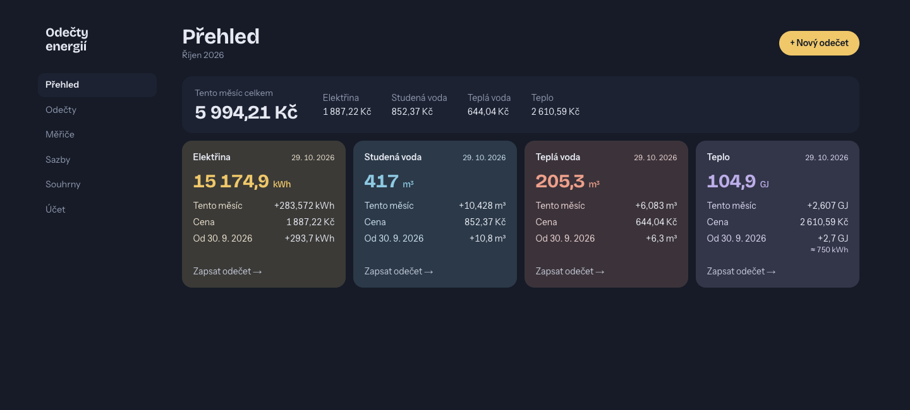
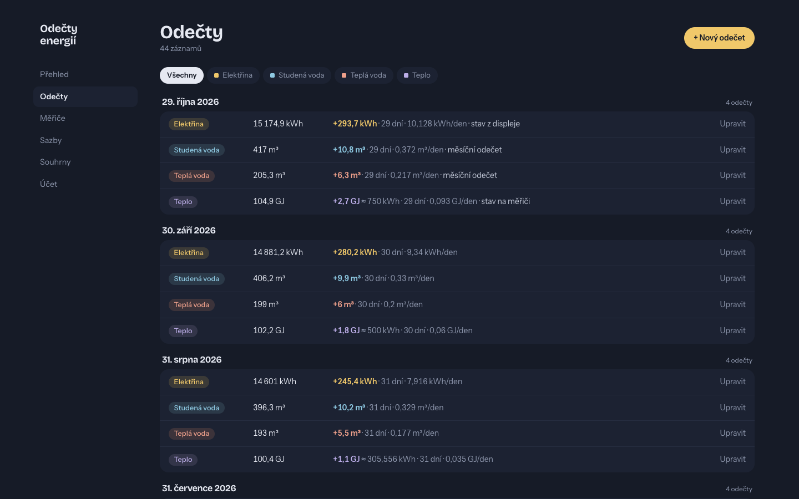
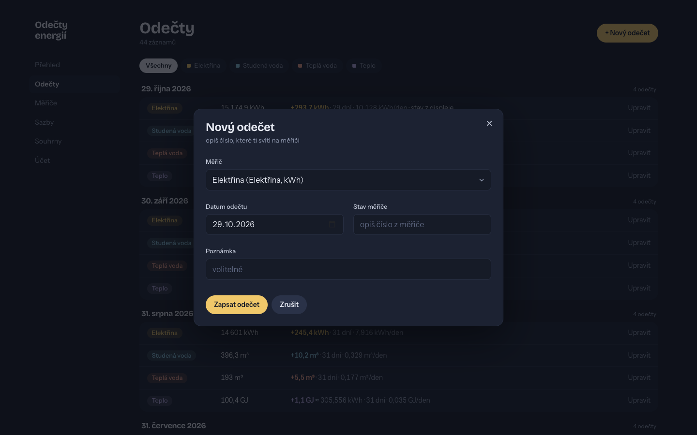
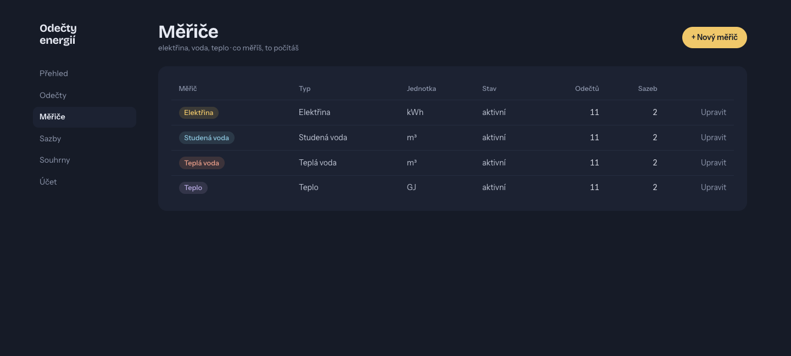
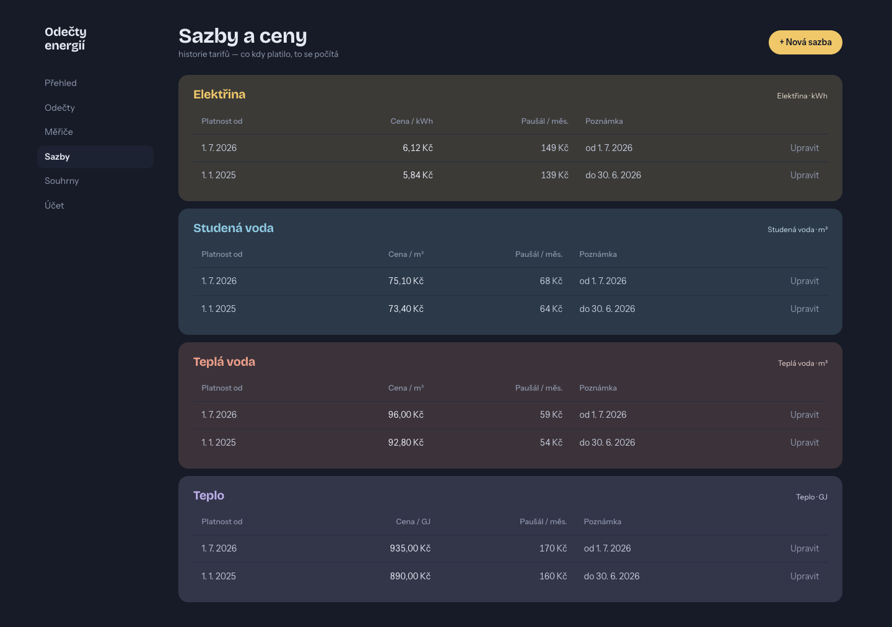
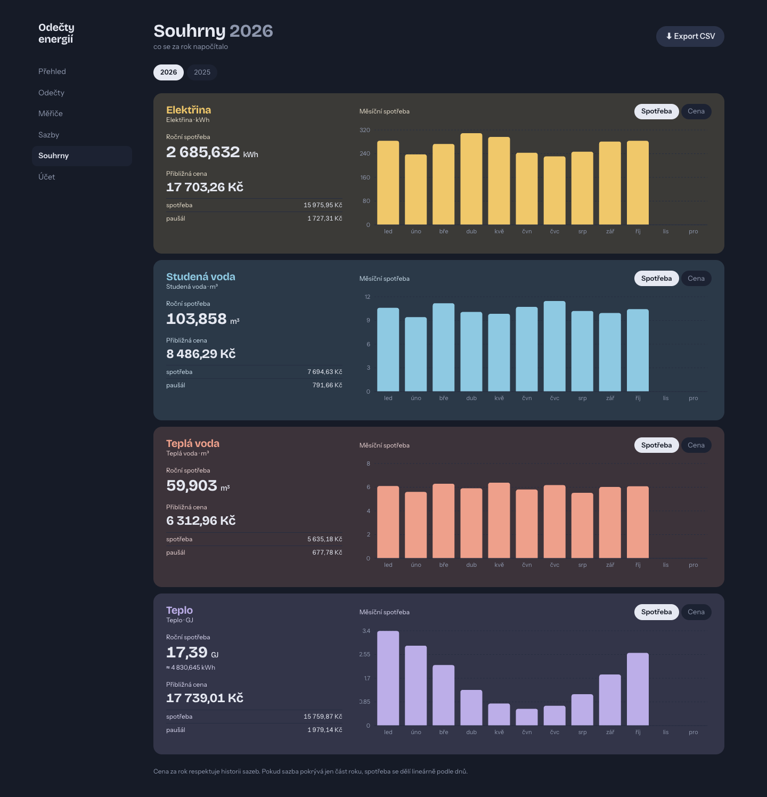

# Odečty energií

Lokální webová aplikace pro evidenci odečtů energií — náhrada za ruční vedení v Excelu.

## Ukázky aplikace

Snímky používají smyšlená data.

<p>
  <a href="screenshots/01-prehled.png"></a>
  <a href="screenshots/02-odecyty.png"></a>
  <a href="screenshots/06-novy-odecet.png"></a>
</p>
<p>
  <a href="screenshots/03-merice.png"></a>
  <a href="screenshots/04-sazby.png"></a>
  <a href="screenshots/05-souhrny-2026.png"></a>
</p>

## Co umí

- Eviduje libovolný počet měřičů (elektřina, studená/teplá voda, teplo) a jejich stavy v čase.
- Spotřebu mezi dvěma odečty počítá automaticky (rozdíl proti předchozímu odečtu).
- U tepla zobrazuje **přepočet GJ → kWh** (1 GJ ≈ 277,78 kWh).
- Sazby s historií platnosti (každá s cenou za jednotku a měsíčním paušálem). Cena za období respektuje změny sazby uprostřed období.
- Dashboard se souhrnem aktuálního měsíce pro každý měřič.
- Souhrny za kalendářní rok s grafem měsíční spotřeby.
- Export všech odečtů do CSV (UTF-8 BOM, otevíratelné v Excelu CZ).
- Soukromé účty se jménem a heslem. Každý účet vidí jen vlastní měřiče a jejich data; nové účty zakládá správce.

## Spuštění

Předpoklady: Node.js 20+.

```bash
npm install
npx prisma generate
DATABASE_URL=file:./prisma/dev.db npx prisma migrate deploy   # vytvoří tabulky podle migrací
DATABASE_URL=file:./prisma/dev.db npm run db:seed             # založí 4 výchozí měřiče
npm run auth:owner -- bootstrap honza  # zeptá se na heslo; přiřadí existující data správci
npm run dev                 # http://localhost:3000
```

U existující lokální databáze vytvořené pomocí `prisma db push` nejdřív označte
úvodní migraci jako aplikovanou a potom spusťte zbývající migrace:

```bash
DATABASE_URL=file:./prisma/dev.db npx prisma migrate resolve --applied 20260518064216_init
DATABASE_URL=file:./prisma/dev.db npx prisma migrate deploy
```

Pro produkční režim:

```bash
npm run build
npm start
```

## Data

Bez `TURSO_DATABASE_URL` používá aplikace lokální `prisma/dev.db` (SQLite). Soubor je `.gitignored`; pro zálohu jej stačí zkopírovat. S `TURSO_DATABASE_URL` a `TURSO_AUTH_TOKEN` používá hostovanou databázi Turso. Vercel dodává obě proměnné přes integraci Turso; `vercel env pull` je může stáhnout do ignorovaného `.env.local` pro lokální přístup ke stejné online databázi. Lokální soubor se s online databází automaticky nesynchronizuje.

### Účty a nasazení stávajících dat

- Přihlašovací jména mají 3–32 znaků (`a–z`, čísla, `_`, `-`) a nerozlišují velikost písmen. Heslo má 12–128 znaků. Správce vytvoří další účty na stránce **Účet → Správa účtů** a předá dočasná hesla mimo aplikaci. Nový uživatel si heslo při prvním přihlášení změní.
- Správce může členovi resetovat heslo nebo vypnout přístup. Vypnutí ponechá data v databázi. Přihlášený uživatel si může změnit vlastní heslo. Ztracené heslo správce lze resetovat příkazem `npm run auth:owner -- reset`; skript vždy zruší staré relace.
- Skript `auth:owner` načítá jen proměnné prostředí procesu. Před zadáním hesla vypíše, zda míří na lokální SQLite nebo Turso. Pro Turso nastavte `TURSO_DATABASE_URL` a `TURSO_AUTH_TOKEN` v prostředí; pokud jsou v `.env.local`, použijte `node --env-file=.env.local --import tsx scripts/owner.ts bootstrap honza` (nebo `reset`). Heslo se zadává skrytě na terminálu, ne jako argument příkazu.
- Před nasazením této verze do produkce zálohujte Turso databázi a aplikujte `prisma/migrations/20261027120000_user_auth/migration.sql` pomocí `turso db shell odecty-energii-data < prisma/migrations/20261027120000_user_auth/migration.sql`. Potom spusťte `auth:owner bootstrap` proti Turso. Skript vytvoří jediný správcovský účet a přiřadí mu všechny dosavadní měřiče včetně odečtů a sazeb; opakované spuštění odmítne.
- Vercel Authentication ponechte zapnutou pro všechny deploymenty, dokud není nová verze nasazena, správce přihlášen a izolace dat ověřena. Teprve poté přepněte ochranu na **Standard Protection**, která dál chrání preview. Produkce pak používá přihlášení aplikace.

## Struktura projektu

```
prisma.config.ts       # Prisma 7 konfigurace (datasource URL, cesta k migracím)
prisma/
  schema.prisma        # datový model (User, Session, Meter, Reading, Tariff)
  seed.ts              # výchozí měřiče
src/
  generated/prisma/    # vygenerovaný Prisma client (gitignored)
  app/                 # Next.js App Router stránky a server actions
  components/          # MeterForm, ReadingForm, ConsumptionChart, …
  lib/
    calculations.ts    # spotřeba, cena za období, měsíční agregace
    format.ts          # cs-CZ formátování čísel, dat, jednotek
    schemas.ts         # Zod schémata pro vstupy
    db.ts              # Prisma client + better-sqlite3 adapter (singleton)
```

## Skripty

| příkaz | popis |
|---|---|
| `npm run dev` | spustí dev server |
| `npm run build` | produkční build |
| `npm start` | spustí produkční build |
| `npm test` | spustí unit testy (vitest) |
| `npm run db:migrate` | aplikuje Prisma migrace ve vývoji |
| `npm run db:seed` | založí výchozí měřiče |
| `npm run db:studio` | otevře Prisma Studio nad lokální DB |

## Pracovní postup

1. **Měřiče** — typicky se nastaví jednou (4 výchozí jsou předvyplněné).
2. **Sazby** — pro každý měřič přidej alespoň jednu sazbu s datem platnosti. Při změně ceny přidej další sazbu — historická období se přepočítají správně.
3. **Odečty** — pravidelně (2–4× měsíčně) zapisuj stav z displeje měřiče.
4. **Přehled / Souhrny** — sleduj spotřebu a odhad ceny.

## Poznámky k výpočtu

- **Spotřeba** mezi odečty = rozdíl stavů (předpokládá se kumulativní měřič).
- **Cena za období** = spotřeba × sazba + měsíční paušál × (počet dní / 30,4375). Když do období spadá změna sazby, spotřeba se mezi segmenty rozdělí lineárně podle dnů.
- **Mimo známá data** (před prvním nebo po posledním odečtu) — aplikace neextrapoluje; spotřeba je 0 v tom úseku.
